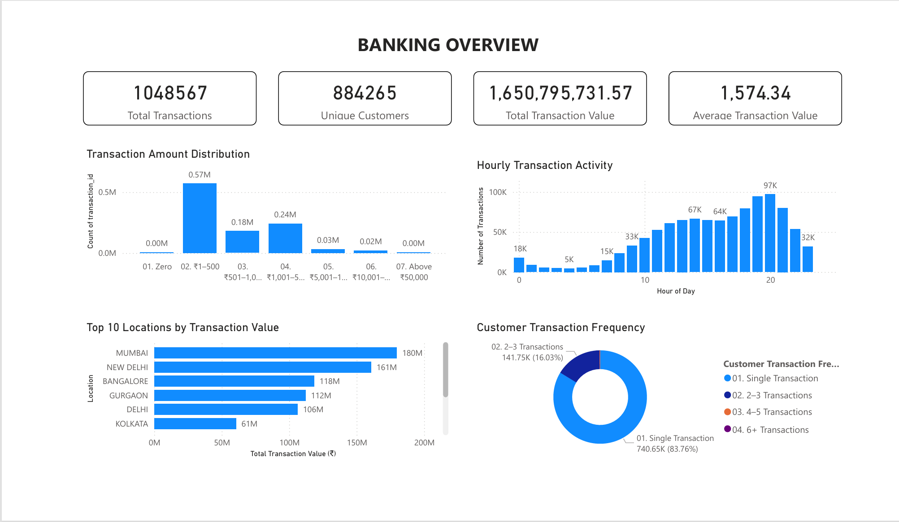
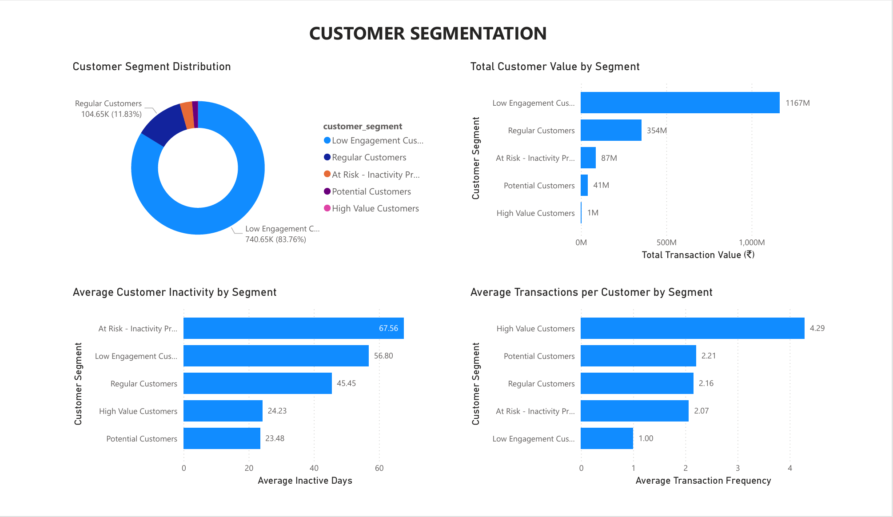
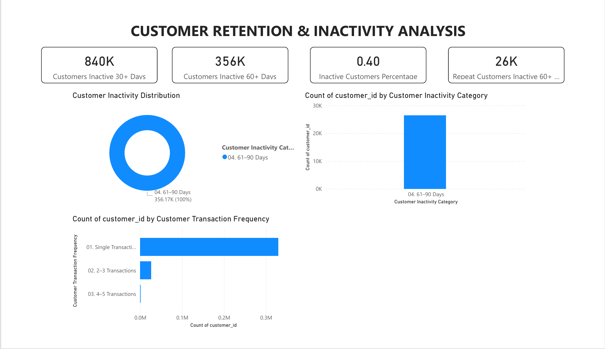

# Bank Customer Transaction & Retention Analytics

An end-to-end data analytics project analyzing over 1 million banking transactions to understand customer behavior, transaction patterns, customer value, RFM segmentation, and historical inactivity trends.

The project uses **PostgreSQL, SQL, Python, and Power BI** to transform raw banking transaction data into actionable analytical insights.

---

## Project Overview

This project analyzes **1,048,567 banking transactions** from 884,265 unique customers.

The objective is to understand transaction behavior, identify valuable customer segments, analyze customer inactivity, and explore historical retention patterns.

### Business Objectives

- Analyze overall banking transaction performance.
- Understand customer demographics and transaction behavior.
- Identify high-value customers and customer segments.
- Analyze transaction frequency and monetary contribution.
- Perform RFM-based customer segmentation.
- Identify customers with historical inactivity patterns.
- Analyze transaction performance across locations and time periods.

---

## Technology Stack

| Technology | Purpose |
|---|---|
| PostgreSQL | Database management |
| SQL | Data analysis and advanced queries |
| Python | Data cleaning, validation, segmentation and visualization |
| Pandas & NumPy | Data processing |
| Matplotlib | Data visualization |
| Power BI | Interactive dashboard |
| Git & GitHub | Version control and project publishing |

---

## Dataset Information

**Dataset:** Bank Customer Segmentation

**Source:** [Kaggle – Bank Customer Segmentation](https://www.kaggle.com/datasets/shivamb/bank-customer-segmentation)

| Metric | Value |
|---|---:|
| Total Transactions | 1,048,567 |
| Unique Customers | 884,265 |
| Original Columns | 9 |
| Cleaned Columns | 11 |
| Total Transaction Value | ₹1.65 Billion |
| Average Transaction Value | ₹1,574.34 |
| Unique Locations | 9,355 |
| Date Range | August 1 – October 21, 2016 |

The dataset contains transaction IDs, customer IDs, demographic information, account balances, transaction dates, transaction times, and transaction amounts.

---

## Project Architecture

1. Dataset Collection
2. Data Inspection and Profiling
3. Data Cleaning and Validation using Python
4. PostgreSQL Database Setup
5. SQL-Based Exploratory Analysis
6. Advanced SQL Analysis
7. Python-Based RFM Segmentation
8. Data Visualization
9. Interactive Power BI Dashboard
10. Business Insights and Documentation

---

## Data Cleaning & Validation

Python was used to clean and validate the original dataset.

Key activities:

- Processed over one million records using chunk-based processing.
- Standardized column names and data formats.
- Converted transaction dates and times into appropriate formats.
- Handled missing demographic and account balance values.
- Identified placeholder dates in customer DOB.
- Created estimated DOB values using a documented century-selection heuristic.
- Standardized gender and customer location values.
- Checked duplicate transaction IDs.
- Validated transaction amounts, account balances, dates, and times.

The original dataset was preserved separately from the cleaned dataset.

---

## SQL Analysis

A total of **8 SQL analysis files containing 64 analytical queries** were developed.

| SQL File | Analysis |
|---|---|
| 01 | Banking Overview |
| 02 | Customer Demographics |
| 03 | Transaction Analysis |
| 04 | Geographic Analysis |
| 05 | Customer Value Analysis |
| 06 | RFM Customer Segmentation |
| 07 | Retention & Inactivity Risk Analysis |
| 08 | Advanced SQL Analysis |

SQL concepts used:

- Aggregate functions
- GROUP BY and HAVING
- Common Table Expressions (CTEs)
- Joins and subqueries
- CASE statements
- Window functions
- RANK, DENSE_RANK and NTILE
- LAG and cumulative calculations
- Customer-level aggregations
- Date and time analysis

---

## Python Analysis

Python was used for data processing, customer segmentation, validation, and visualization.

### Customer Segmentation

An RFM model was developed using:

- **Recency:** Days since the customer's last transaction.
- **Frequency:** Total number of transactions.
- **Monetary:** Total transaction value.

The reference date for RFM calculations is October 21, 2016, the latest transaction date in the dataset.

### Visualizations

Eight visualizations were generated:

1. Transaction Amount Distribution
2. Daily Transaction Trends
3. Hourly Transaction Activity
4. Top 10 Locations
5. Customer Transaction Frequency
6. RFM Customer Segments
7. Customer Inactivity Distribution
8. High-Value Inactive Customers

All charts were exported as high-resolution PNG files.

---

## Power BI Dashboard

An interactive Power BI dashboard was developed with three analytical pages.

### 1. Banking Overview

- Total Transactions
- Unique Customers
- Total Transaction Value
- Average Transaction Value
- Transaction Amount Distribution
- Hourly Transaction Activity
- Top Locations by Transaction Value
- Customer Transaction Frequency

### 2. Customer Segmentation

- Customer Segment Distribution
- Total Customer Value by Segment
- Average Customer Inactivity by Segment
- Average Transactions per Customer by Segment

### 3. Customer Retention & Inactivity

- Customers Inactive 30+ Days
- Customers Inactive 60+ Days
- Inactive Customer Percentage
- Repeat Customers Inactive 60+ Days
- Customer Inactivity Distribution
- Repeat Customer Inactivity Analysis
- Customer Inactivity by Transaction Frequency

## Dashboard Screenshots

### Banking Overview



### Customer Segmentation



### Customer Retention & Inactivity



---

## Key Business Insights

- The dataset contains 1,048,567 transactions from 884,265 unique customers.
- Total transaction value is approximately ₹1.65 billion.
- The average transaction value is ₹1,574.34.
- Approximately 83.76% of customers made only one recorded transaction.
- Customers with 2–5 transactions account for approximately 16.24% of customers.
- Customers inactive for more than 60 days account for approximately 40.28% of all customers.
- Mumbai, New Delhi, Bangalore, Gurgaon, and Delhi are among the leading locations by transaction value.
- 20:00 is the hour with the highest recorded transaction volume.
- High-value transactions above ₹50,000 account for approximately 13.65% of total transaction value, despite representing only 0.23% of transactions.

---

## Important Data Limitations

- The dataset does not contain an actual customer churn or account-closure indicator. Inactivity is used only as a historical retention-risk proxy.
- The observation period is limited to August–October 2016, with incomplete date coverage, particularly in September and October.
- Customer DOB values include missing records and placeholder dates. Estimated ages are based on a documented heuristic and should not be treated as verified demographic information.
- Some customers have conflicting gender records. A separate customer-level classification was derived for analytical purposes.
- Account balance is recorded at the transaction level and should not be interpreted as a static customer balance.
- RFM score thresholds and customer segment definitions are analyst-defined.
- Inactivity calculations use October 21, 2016 as the reference date, not the current date.

These limitations should be considered when interpreting the findings.

---

## Project Structure

```text
bank-customer-retention-analytics/
│
├── dataset/                  # Local only (not tracked by Git)
│   ├── raw/                  # Original Kaggle dataset
│   └── processed/            # Cleaned dataset/
│
├── python/
│   ├── inspect_dataset.py
│   ├── clean_dataset.py
│   ├── validate_dataset.py
│   ├── customer_segmentation.py
│   └── visualizations.py
│
├── sql/
│   ├── 01_banking_overview.sql
│   ├── 02_customer_demographics.sql
│   ├── 03_transaction_analysis.sql
│   ├── 04_geographic_analysis.sql
│   ├── 05_customer_value_analysis.sql
│   ├── 06_rfm_segmentation.sql
│   ├── 07_retention_risk_analysis.sql
│   └── 08_advanced_sql_analysis.sql
│
├── powerbi/
│   └── Bank_Customer_Analytics.pbix
│
├── reports/
│   ├── visualizations/
│   ├── rfm_segment_summary.csv
│   └── Bank_Customer_Dashboard.pdf
│
├── screenshots/
│   ├── 01_banking_overview.png
│   ├── 02_customer_segmentation.png
│   └── 03_retention_inactivity.png
│
├── README.md
├── requirements.txt
└── .gitignore
```

---

## Conclusion

This project demonstrates an end-to-end banking analytics workflow, combining SQL, Python, and Power BI to analyze large-scale transaction data and derive insights into customer behavior, transaction value, segmentation, and historical inactivity patterns.

It showcases practical skills in data cleaning, exploratory data analysis, advanced SQL, RFM-based customer segmentation, data visualization, and interactive dashboard development.

The analysis also highlights the importance of interpreting customer inactivity as a historical retention-risk proxy rather than confirmed customer churn.

---

**Author:** Arshad Jamal  
**Project:** Bank Customer Transaction & Retention Analytics